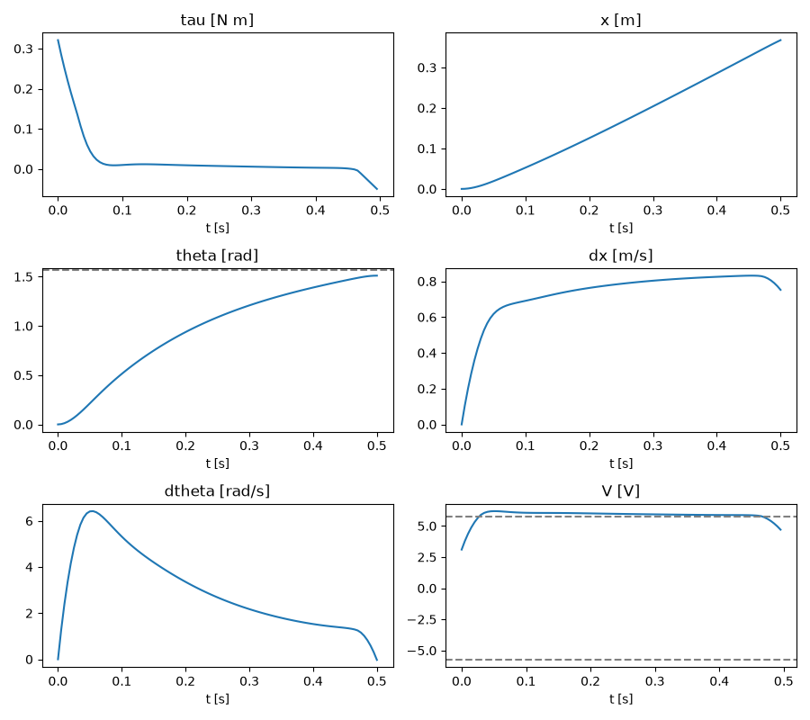

# 02 Segway の起き上がり軌道（最急降下法）

## 概要

前に倒れて床に寝ている Balboa 32U4 が、車輪を回して直立するまでの起き上がり軌道を、
間接法（最急降下法）で生成する。

- ハミルトニアンの偏微分は SymPy で自動で求める（[01 練習問題](../01_practice_ocp/) の `ocp_sympy.py` と同じ構成）
- モータの電圧の上限と、車体が床を突き抜けないことをペナルティで評価関数に入れる
- 求めた軌道は、実機シミュレータの軌道と同じ形式の CSV に保存する

## 問題設定

状態 $X=[x,\ \theta,\ \dot{x},\ \dot{\theta}]$、制御入力 $\tau$（2輪合計の車輪トルク）

- $x$：車輪の位置 [m]
- $\theta$：車体の角度 [rad]。水平から反時計回りに測り、$0$ が前に寝た状態、$\pi/2$ が直立

**状態方程式**

$$
\begin{bmatrix}
m_1+m_2+\dfrac{I_1}{r^2} & -m_2 s\sin\theta\\
-m_2 s\sin\theta & I_2+m_2 s^2
\end{bmatrix}
\begin{bmatrix}\ddot{x}\\ \ddot{\theta}\end{bmatrix}
=
\begin{bmatrix}
m_2 s\cos\theta\,\dot{\theta}^2+\dfrac{\tau}{r}\\
-m_2 g s\cos\theta+\tau
\end{bmatrix}
$$

**モータ1個にかかる電圧**

$$
V=\frac{R_a}{K_t}\cdot\frac{\tau}{2}+K_e\left(\frac{\dot{x}}{r}+\dot{\theta}\right)
$$

$\dot{x}/r+\dot{\theta}$ は、車体に対する車輪の回転速度。

**評価関数**

$$
J=\sum_{i}\frac{S_i}{2}\left(X_i(t_f)-X_{f,i}\right)^2
+\int_{0}^{t_f}\left\{\rho+\frac{R}{2}\tau^2+P_V+P_a+P_{floor}\right\}dt
$$

| 項 | 内容 |
|---|---|
| $\frac{S_i}{2}(X_i(t_f)-X_{f,i})^2$ | 終端で直立・静止していないことへのペナルティ（$x$ はどこで起き上がってもよいので重み 0） |
| $\rho$ | 動作時間（$t_f$ 固定なので定数） |
| $\frac{R}{2}\tau^2$ | 入力（消費エネルギー） |
| $P_V$ | $\lvert V\rvert$ が上限 $V_{max}$ を超えた分の2乗 |
| $P_a$ | $\lvert\ddot{x}\rvert$ が上限 $a_{max}$ を超えた分の2乗（今回は重み 0 で使わない） |
| $P_{floor}$ | $\theta<0$ または $\theta>\pi$（床を突き抜けた）ときの2乗 |

**境界条件**

$$
X(0)=[0,\ 0,\ 0,\ 0],\quad X_f=[0,\ \pi/2,\ 0,\ 0],\quad t_f=0.5\ \mathrm{s}
$$

## パラメータ

| 記号 | 値 | 内容 |
|---|---|---|
| $m_1$ | 0.06 kg | 車輪2輪の合計質量（暫定値。未測定） |
| $m_2$ | 0.288 kg | 車体質量（実測：電池込み、ホイール除外） |
| $I_1$ | 4.8e-5 kg m² | 車輪2輪の合計慣性（暫定値。未測定） |
| $I_2$ | 1.0e-3 kg m² | 車体の重心まわり慣性（暫定値。未測定） |
| $s$ | 0.0165 m | 車軸から車体重心まで（実測） |
| $r$ | 0.04 m | 車輪半径（実測：直径 8 cm） |
| $R_a$ | 3.75 Ω | 巻線抵抗 |
| $K_t$ | 0.194 N m/A | トルク定数 |
| $K_e$ | 0.264 V s/rad | 逆起電力定数 |
| $V_{max}$ | 5.76 V | 電圧の上限（電池 7.2 V の 8 割） |
| $a_{max}$ | 3.92 m/s² | 加速度の上限（摩擦係数 0.5（仮）でスリップしない目安の 8 割） |

モータの定数は、ギヤ込みで「車輪の軸に直接つながった1個のモータ」とみなした値（モータ1個あたり）。
実機シミュレータと同じ決め方・同じ値にしてある。

## 解き方

1. $\tau(t)=0$ から始める
2. 状態方程式を $t=0$ から順時間方向に解く（4次のルンゲ・クッタ、$\Delta t=0.005$ s）
3. 随伴方程式 $\dot{\lambda}=-\partial H/\partial X$ を $\lambda(t_f)=\partial\phi/\partial X$ から逆時間方向に解く
4. $\tau \leftarrow \tau-\alpha\,\partial H/\partial\tau$ で更新する。ステップ幅 $\alpha$ は $J$ が減るまで半分にする（バックトラッキング）
5. $\partial H/\partial\tau$ のノルムが初回の $10^{-5}$ 倍より小さくなるか、10000 回に達するまで 2〜4 を繰り返す

## ファイル

| ファイル | 内容 |
|---|---|
| segway_swingup_sd.py | 最急降下法で起き上がり軌道を求める |
| swingup_sd.csv | 求めた軌道（列：`t,x,theta,dx,dtheta,tau`） |
| swingup_sd.png | 求めた軌道とモータ1個にかかる電圧 $V$ のグラフ（プログラムを実行すると保存される） |

## 結果

10000 回で反復を打ち切った（収束判定は満たしていない）。以下はその時点の値。

| 項目 | 値 |
|---|---|
| 評価関数 J | 4.709 |
| 終端状態 | $x$ = 0.367 m, $\theta$ = 86.53 deg, $\dot{x}$ = 0.752 m/s, $\dot{\theta}$ = −0.028 rad/s |
| $\theta$ の範囲 | 0.0 ～ 86.5 deg（床は突き抜けていない） |
| 最大トルク $\lvert\tau\rvert$ | 0.321 N m |

実機の制約との比較

| 項目 | 最大値 | 上限 | |
|---|---|---|---|
| 電圧 $\lvert V\rvert$ | 6.19 V | 5.76 V | 超えている |
| 加速度 $\lvert\ddot{x}\rvert$ | 21.23 m/s² | 3.92 m/s² | 超えている（ペナルティの重み 0） |
| 車輪の回転速度 | 22.8 rad/s | 21.8 rad/s（目安：$V_{max}/K_e$、電圧の上限だけで回せる速さ） | 超えている |

電圧 $V$ のグラフの破線は上限 $\pm V_{max}$。
$V$ は $t$ = 0.03 ～ 0.47 s のほぼ全体で上限 5.76 V を超えている（最大 6.19 V、$t$ = 0.05 s）。
電圧はペナルティとして入れているだけなので、上限を少し超えた状態で反復が止まっている。

## 考察

---

前の章：[01 練習問題：物体持ち上げ動作における操作力最小化問題](../01_practice_ocp/)　次の章：[03 Segway の起き上がり軌道（直接法）](../03_swingup_direct_method/)
