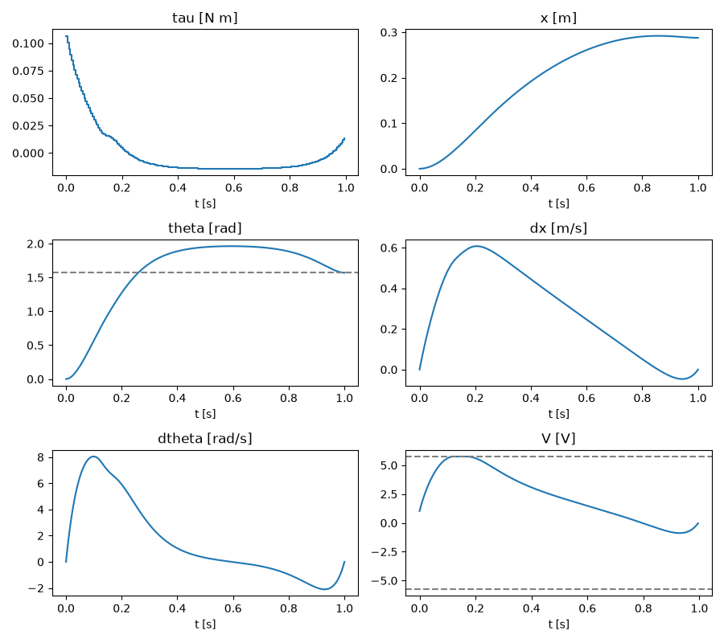

# 03 Segway の起き上がり軌道（直接法）

## 概要

前に倒れて床に寝ている Balboa 32U4 が、車輪を回して直立するまでの起き上がり軌道を、
直接法（多重シューティング、CasADi＋IPOPT）で生成する。

- 時間を区切って状態と入力を変数にし、非線形計画問題として IPOPT で解く（[01 練習問題](../01_practice_ocp/) の `ocp_casadi.py` と同じ方法）
- モータの電圧の上限・加速度の上限・車体が床を突き抜けないことを、ペナルティではなく制約条件として入れる
- 終端で直立・静止することも制約条件として入れる（[02 最急降下法](../02_swingup_steepest_descent/) では終端ペナルティ）
- 求めた軌道は、実機シミュレータの軌道と同じ形式の CSV に保存する

## 問題設定

状態・制御入力・状態方程式・モータ1個にかかる電圧は、[02 最急降下法](../02_swingup_steepest_descent/README.md#問題設定) と同様。
評価関数・制約条件・境界条件の入れ方だけが 02 と異なる。

**評価関数**

$$
J=\int_{0}^{t_f}\tau^2\,dt\ \approx\ \sum_{k=0}^{N-1}\tau_k^2\,\Delta t
$$

入力（消費エネルギー）だけを評価する。$\tau_k$ は各区間で一定。

**制約条件**

| 制約 | 内容 |
|---|---|
| $X_{k+1}=F(X_k,\ \tau_k)$ | 区間のつながり（$F$ は状態方程式を $\Delta t$ だけ 4次のルンゲ・クッタで進めたもの） |
| $\lvert V_k\rvert\le V_{max}$ | モータの電圧の上限 |
| $\lvert\ddot{x}_k\rvert\le a_{max}$ | 加速度の上限（スリップしない目安） |
| $0\le\theta_k\le\pi$ | 床を突き抜けない |

**境界条件**

$$
X(0)=[0,\ 0,\ 0,\ 0],\quad X(t_f)=[\text{自由},\ \pi/2,\ 0,\ 0],\quad t_f=1.0\ \mathrm{s}
$$

$x$ はどこで起き上がってもよいので終端では指定しない。

## パラメータ

| 記号 | 値 | 内容 |
|---|---|---|
| $m_1$ | 0.06 kg | 車輪2輪の合計質量（暫定値。未測定） |
| $m_2$ | 0.288 kg | 車体質量（実測：電池込み、ホイール除外） |
| $I_1$ | 4.8e-5 kg m² | 車輪2輪の合計慣性（暫定値。未測定） |
| $I_2$ | 2.2e-4 kg m² | 車体の重心まわり慣性（振り子法） |
| $s$ | 0.0165 m | 車軸から車体重心まで（実測） |
| $r$ | 0.04 m | 車輪半径（実測：直径 8 cm） |
| $R_a$ | 3.75 Ω | 巻線抵抗 |
| $K_t$ | 0.194 N m/A | トルク定数 |
| $K_e$ | 0.264 V s/rad | 逆起電力定数 |
| $V_{max}$ | 5.76 V | 電圧の上限（電池 7.2 V の 8 割） |
| $a_{max}$ | 7.85 m/s² | 加速度の上限（摩擦係数 1.0（仮）でスリップしない目安の 8 割） |

モータの定数は、ギヤ込みで「車輪の軸に直接つながった1個のモータ」とみなした値（モータ1個あたり）。
実機シミュレータと同じ決め方・同じ値にしてある。

## 解き方

1. $t_f$ を $N=200$ 区間に分ける（$\Delta t=0.005$ s）
2. 各節点の状態 $X_0,\dots,X_N$ と各区間のトルク $\tau_0,\dots,\tau_{N-1}$ を変数にする
3. 区間のつながり・電圧・加速度・床・境界条件を制約条件として、CasADi の `Opti` で非線形計画問題を作る
4. 初期値は $\theta$ を $0$ から $\pi/2$ まで直線で増やしたもの（ほかの変数は 0）にする
5. IPOPT で解く

## ファイル

| ファイル | 内容 |
|---|---|
| segway_swingup_direct_casadi.py | 直接法で起き上がり軌道を求める |
| swingup_direct.csv | 求めた軌道（列：`t,x,theta,dx,dtheta,tau`。最後の行の `tau` は使わないので 0） |
| swingup_direct.png | 求めた軌道とモータ1個にかかる電圧 $V$ のグラフ（プログラムを実行すると保存される） |

## 結果

IPOPT は収束した。

| 項目 | 値 |
|---|---|
| 評価関数 J | 0.000609 |
| 終端状態 | $x$ = 0.288 m, $\theta$ = 90.00 deg, $\dot{x}$ = 0.000 m/s, $\dot{\theta}$ = 0.000 rad/s |
| $\theta$ の範囲 | 0.0 ～ 112.5 deg（床は突き抜けていない） |
| 最大トルク $\lvert\tau\rvert$ | 0.107 N m |

実機の制約との比較

| 項目 | 最大値 | 上限 | |
|---|---|---|---|
| 電圧 $\lvert V\rvert$ | 5.76 V | 5.76 V | 上限ちょうど（制約が効いている） |
| 加速度 $\lvert\ddot{x}\rvert$ | 7.05 m/s² | 7.85 m/s² | 守れている |
| 車輪の回転速度 | 21.4 rad/s | 21.8 rad/s（目安：$V_{max}/K_e$、電圧の上限だけで回せる速さ） | 守れている |

電圧 $V$ のグラフの破線は上限 $\pm V_{max}$。
$V$ は $t$ = 0.12 ～ 0.17 s で上限 5.76 V に張り付いている（電圧の制約が効いている）。
それ以外の時間は上限より小さく、負側は最小 −0.88 V。

## 考察

---

前の章：[02 Segway の起き上がり軌道（最急降下法）](../02_swingup_steepest_descent/)
